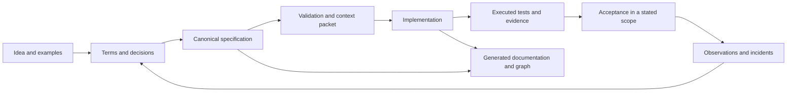

# AxiomSpec

A format for product specifications that a program can check, with stable IDs, typed links, bounded constraints and evidence from executed tests.

**Edition 1.1.4 · 12 November 2026**
Specification format: `axiomspec/0.3` · Profile: `AX-CORE-0.3` · Report format: `axiomspec-report/0.4`.

This package holds the contracts for a local requirements workflow and what an implementation needs to follow them: JSON schemas, a worked example with a reference implementation and executed tests, reference checks for releases, approvals and a release store, a service interface with reference queries, migrations from formats 0.1 and 0.2, and the QA that checks the package itself. The local `axiom.py` command checks a supplied specification and generates its Markdown reading view. It does not implement the full product-phase engine or a runner adapter, and the queries are reference code. [aeion-factory](https://github.com/OualidGuennif/aeion-factory) has an engine built from edition 0.3.0 of these contracts; it reads format 0.1, and this package's QA does not test it.

A specification links an intended outcome to defined terms, requirements, constraints, scenarios, bindings to the code, and evidence. Open questions and decisions are recorded in it as items of their own. The checks make the declared properties reproducible. They cannot tell whether the requirements are complete or right for the business; that stays with the people who approve them.

## Workflow



## Design choices

- Each product has one editable `spec.json`. Documentation and graphs are generated from it.
- The core runs locally and gives the same answer every time. It needs no model API, server, graph database or agent orchestrator.
- Constraints are written in BCIR, a small proposed representation. A qualified modeling tool can be used instead.
- Relationships are typed and say where they come from. A declared link to code does not show that the code behaves as required.
- Queries are bounded, and a context includes every rule it needs: a response budget never drops one.
- Evidence records the revisions of the specification, the source, the policy, the tool and the observations it was produced from.
- Every specification has a version. Comparing two releases lists what changed by ID, which changes may break consumers, and the version step they require.
- Every requirement has an integer weight from 1 to 100 points, in declared minor units, and a change has a risk score computed from those weights. The score sets the order of review; a failed check stays failed whatever the score.
- Feature flags are declared in the specification, with a state per release, a test for each state and a date by which the flag must go.
- The specification states its approval policy: how many approvers each risk band needs and which methods count. Both are the organization's choice, and signatures are checked against the release before.
- There is one specification per product or service. A specification pins the releases it relies on by digest, and a large one can be stored in parts.
- An agent works from an index and from annotations in the code. It asks a read-only service, over HTTP or MCP, for one requirement, for what constrains it, or for the context of a change.
- Verification reads files only. There is no log, index, quorum or clock, so the verdict is the same in any order and from any copy of the files.

## Reading guide

| Task | Documents |
|---|---|
| Build the tool | [Implementation handoff](docs/00_IMPLEMENTATION_HANDOFF.md), [incremental plan](docs/12_IMPLEMENTATION_PLAN.md) |
| Understand the basis | [Foundations and references](docs/01_FOUNDATIONS.md), [principles](docs/02_PRINCIPLES_AND_SCOPE.md) |
| Write a product specification | [Authoring workflow](docs/04_AUTHORING_WORKFLOW.md), [templates](docs/15_TEMPLATES_AND_PROMPTS.md) |
| Implement validation | [Canonical model](docs/03_CANONICAL_MODEL.md), [constraint semantics](docs/05_CONSTRAINTS_AND_SEMANTICS.md), [gates](docs/06_GATES_AND_EVIDENCE.md) |
| Retrieve coding context | [Graph and queries](docs/07_KNOWLEDGE_GRAPH_AND_QUERIES.md), [agent contract](docs/08_AGENT_CODING_CONTRACT.md), [context admission](docs/17_CONTEXT_DOMAIN_INTERFACE.md) |
| Verify and maintain behavior | [Testing](docs/09_TEST_STRATEGY_AND_CLOSED_LOOP.md), [change control](docs/10_LIFECYCLE_AND_CHANGE_CONTROL.md), [risk and extensions](docs/11_RISK_SECURITY_AND_EXTENSIONS.md) |
| Version, weigh and flag | [Release, weights and flags](docs/03_CANONICAL_MODEL.md#releases-weights-and-flags), [release comparison and risk score](docs/10_LIFECYCLE_AND_CHANGE_CONTROL.md#releases) |
| Serve requirements to agents | [Service interface](docs/19_SERVICE_INTERFACE.md), [HTTP contract](api/openapi.json), [MCP tools](api/mcp-tools.json) |
| Approve, compose and store | [Approval, imports and parts](docs/03_CANONICAL_MODEL.md#approval-composition-and-storage), [approval verification](docs/06_GATES_AND_EVIDENCE.md#ax-g-014--approval-verification), [release store and impact](docs/10_LIFECYCLE_AND_CHANGE_CONTROL.md#ax-l-010--release-store) |
| Inspect an example | [Ledger walkthrough](docs/13_REFUND_LEDGER_WALKTHROUGH.md), [canonical data](examples/refund-ledger/spec.json) |
| Declare execution mode | [Task execution and decision policy](docs/08_AGENT_CODING_CONTRACT.md) |
| Prepare CROA inputs | [Optional readiness profile](docs/18_CROA_READINESS.md) |
| Assess the package | [Conformance corpus](docs/14_CONFORMANCE_SUITE.md), [acceptance limits](docs/16_ACCEPTANCE_AND_LIMITS.md), [review](REVIEW.md), [validation](VALIDATION.md) |

The [rule index](RULE_INDEX.md) links every normative `AX-*` rule. The schemas define structure and the contracts define the rest of the meaning. If a schema, a contract and a fixture disagree, settle it explicitly before shipping an implementation.

The ledger is fictional. Its formulas have reference checks, and its 20 test cases run against a reference implementation on SQLite each time the package is verified. The package QA reports no phase status, and the [walkthrough](docs/13_REFUND_LEDGER_WALKTHROUGH.md) lists what is still open.

## Editions

Edition 0.5.0 moved the core format to `axiomspec/0.2`, which requires a release, weights and flags. A 0.1 specification is not valid 0.2; `python3 qa/migrate_0_1.py` writes a candidate and lists what a person still has to decide. Edition 0.5.1 added 1000 as a weight unit and audit scenarios to the ledger. Editions 0.3.1 and 0.4.0 kept format 0.1.

Edition 0.6.0 moved the core format to `axiomspec/0.3`, which requires an approval policy, imports and exports. `python3 qa/migrate_0_2.py` writes a candidate with a policy of zero approvers, for the organization to replace. The [review](REVIEW.md#edition-060) lists each change.

Edition 0.7.0 added the service interface and kept format 0.3: a graph index, `@req` annotations, bounded queries, and a contract for HTTP and MCP. The [review](REVIEW.md#edition-070) gives the reasons and the measurements. Edition 0.7.1 fixed ten defects found by a review of that code, four of them in how the store behaved under hostile or concurrent input; the [review](REVIEW.md#edition-071) lists each one with its regression test. Edition 0.7.2 fixed what a second pass found and closed the two gaps of the ledger: a predicate and scenarios for the report (REQ-010), and a counterexample for tenant isolation (REQ-004).

Edition 1.0.0 was the first tagged release. It fixed what a third pass found, including an approvals file that could block a release depending on the order the store read it, and kept format 0.3. The version number means the release is published and will not change; it does not mean the engine is qualified, and the [review](REVIEW.md#edition-100) says what it covers. Edition 1.0.1 requires Python 3.14 or later. Edition 1.0.2 rewrites the READMEs and the release notes in plainer language. Neither changes the format, the checks or the service.

Edition 1.1.0 adds the file checker and the Markdown generator. A release now passes the store only when its whole ancestor chain passes, an invalid reference graph is set apart, response budgets are enforced, and a code scan that cannot run is reported. Python annotations are read only from comments and real docstrings. The format stays 0.3, and the [change record](REVIEW.md#edition-110) lists each change.

Edition 1.1.1 gives the FastAPI service a Docker image on Python 3.15, with worker processes, health probes, a cap on requests in flight and deadlines for request bodies, over both REST and MCP. Concurrent publication is durable and has recovery tests. A pinned read checks its own source files, including the parts of a split specification, and no longer lists unrelated releases. The deployment guide ships with the full repository; this package alone keeps the file tools and the contracts.

Edition 1.1.2 fixes four defects found in 1.1.1. Enum changes that hold objects or arrays are compared correctly, the store and the candidates use the same environment checks as the checker, MCP accepts HTTPS origins you list explicitly, and a malformed part gives a clean error. It also adds the `compare` and `verify-store` commands. The [change record](REVIEW.md#edition-112) has the details.

Edition 1.1.3 fixes two defects in the annotation scan: a form feed or a line separator in a source file no longer hides the `@req` annotations after it, and a Python file that starts with a byte-order mark keeps its docstring annotations and symbols. `POST /v1/candidates` now answers 201 with a `Location` only when the candidate is held, and 200 when it is refused. The [change record](REVIEW.md#edition-113) has the details.

Edition 1.1.4 fixes two defects. The annotation scan reads a source file that is not valid UTF-8, such as a cp1252 file with an accent in a comment, instead of skipping it with all its `@req` annotations. A `PUT` or `POST` sent with `If-None-Match` now always gets its status and body; 304 is kept for reads. The repository check also compares the edition named by the Dockerfile, the Compose file and the container check. The [change record](REVIEW.md#edition-114) has the details.

## Commands

With the QA dependencies installed, run these from the package directory:

```bash
python3 axiom.py check examples/refund-ledger/spec.json
python3 axiom.py check examples/refund-ledger/spec.json --json
python3 axiom.py markdown examples/refund-ledger/spec.json --output ledger.md
python3 axiom.py compare examples/refund-ledger/releases/1.0.0.json examples/refund-ledger/spec.json
python3 axiom.py compare examples/refund-ledger/releases/1.0.0.json examples/refund-ledger/spec.json --format markdown --output changes.md
python3 axiom.py verify-store examples --json
```

`check` reads strict JSON and verifies the schema, the restricted environment shapes and selected reference rules. It exits with 0 on pass, 2 on a failed check and 4 when the input cannot be read or processed. It keeps the first 50 schema errors in sorted order and still reports the exact total. It does not evaluate BCIR, verify signatures, run tests or decide a product phase.

`markdown` runs the same checks first, then writes a view of every node, its links, the open decisions and the metadata. The output is the same for the same input. Edit `spec.json` and regenerate the view; the Markdown is not a second source.

`compare` checks both inputs, then runs the G14 comparison: changed IDs, the version step, compatibility errors and the risk score. It prints JSON by default, and `--format markdown` gives a report to read. A comparison that fails G14 is still printed, with exit code 2. If an input fails its checks, you get the check report and code 2, and in Markdown mode that report goes to stderr and no file is created.

`verify-store` takes files or directories and checks release chains, signatures, approval policies and pinned imports. It prints a summary, with what is missing for each incomplete release, and `--json` gives the full report. It exits with 0 on pass, 2 on fail, 3 when something is missing (an ancestor or a provider, for instance) and 4 when a path cannot be read. A pass says nothing about product readiness or about who holds a key.

`check`, `markdown` and `compare` accept a specification or a parts manifest. All four commands work from any directory and write to stdout, or with `--output` to a new file. They never overwrite a file and never write into the store. When `compare` or `verify-store` fails to process its input in JSON mode, the error has the format `axiomspec-cli-error/0.1`.

Install the [QA dependencies](qa/requirements-qa.txt), then replay the package checks with `python3 qa/run_checks.py`. The standalone scripts `qa/release_diff.py` and `qa/release_store.py` remain available. Check individual approvals with `python3 qa/approvals.py verify <spec.json> <approvals.json> [<baseline.json>]`. The [assurance matrix](review/ASSURANCE_MATRIX.md) separates declared contracts, package checks that exist, and product capabilities that do not.

Start with the handoff and the contracts for the increment you are building. A coding session does not need the whole package loaded.
