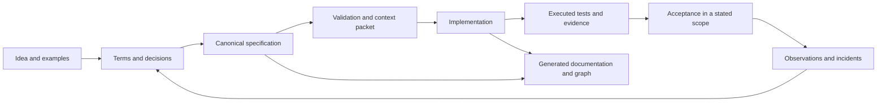

# AxiomSpec

Augmented specifications with explicit models, bounded constraints and traceable verification.

**Edition 0.7.1 · 11 November 2026**  
Specification format: `axiomspec/0.3` · Profile: `AX-CORE-0.3` · Report format: `axiomspec-report/0.4`.

This package defines a local requirements workflow and the contracts for an implementation. It includes schemas, a worked example with a reference implementation and executed tests, reference observations, reference checks of releases, approvals and a release store, a service interface with reference queries, migrations from formats 0.1 and 0.2 and package QA. It contains no product CLI or runner adapter, and its queries are references, not a qualified engine. An engine built from edition 0.3.0 of these contracts exists separately in [aeion-factory](https://github.com/OualidGuennif/aeion-factory); it reads format 0.1 and this package's QA does not qualify it.

An augmented specification connects an intended outcome to defined terms, requirements, constraints, scenarios, implementation bindings and evidence. It records uncertainty and decisions explicitly. Deterministic checks make declared properties reproducible; they do not establish that the chosen requirements are complete or correct for the business.

## Workflow

## Design choices

- One editable `spec.json` per product. Product documentation and graphs are derived views.
- A deterministic local core. No model API, server, graph database or agent orchestrator is required.
- A small proposed constraint representation, BCIR. Existing qualified modeling tools may be reused instead.
- Typed relationships and explicit provenance. A declared implementation link is not proof of behavior.
- Bounded queries and mandatory context closure. Required rules are never silently removed to fit a response budget.
- Evidence tied to specification, source, policy, tool and observation revisions.
- A version on every specification and a deterministic comparison between two releases: what changed by ID, which changes are breaking candidates, and the version step they require.
- An integer weight on every requirement, from 1 to 100 points in declared minor units, and a change risk score computed from it. The score ranks; it never turns a failed gate into a pass.
- Feature flags declared in the specification with a state per release, a test for each state and a removal target.
- An approval policy in the specification: approvers per risk band and accepted methods, both the organization's choice, and signatures checked against the release before.
- One specification per product or service. A specification pins the releases it relies on by digest, and a large one is stored in parts.
- An agent works from an index and annotations, not from the whole specification. It asks a read-only service for one requirement, for what binds it, or for the context of a change, over HTTP or MCP.
- Verification from files alone. No log, index, quorum or clock: the verdict depends only on the set of files, in any order, from any replica.

## Reading guide

| Task | Documents |
|---|---|
| Build the tool | [Implementation handoff](docs/00_IMPLEMENTATION_HANDOFF.md), [incremental plan](docs/12_IMPLEMENTATION_PLAN.md) |
| Understand the basis | [Foundations and references](docs/01_FOUNDATIONS.md), [principles](docs/02_PRINCIPLES_AND_SCOPE.md) |
| Write a product specification | [Authoring workflow](docs/04_AUTHORING_WORKFLOW.md), [templates](docs/15_TEMPLATES_AND_PROMPTS.md) |
| Implement validation | [Canonical model](docs/03_CANONICAL_MODEL.md), [constraint semantics](docs/05_CONSTRAINTS_AND_SEMANTICS.md), [gates](docs/06_GATES_AND_EVIDENCE.md) |
| Retrieve coding context | [Graph and queries](docs/07_KNOWLEDGE_GRAPH_AND_QUERIES.md), [agent contract](docs/08_AGENT_CODING_CONTRACT.md), [context admission](docs/17_CONTEXT_DOMAIN_INTERFACE.md) |
| Verify and maintain behavior | [Testing](docs/09_TEST_STRATEGY_AND_CLOSED_LOOP.md), [change control](docs/10_LIFECYCLE_AND_CHANGE_CONTROL.md), [risk and extensions](docs/11_RISK_SECURITY_AND_EXTENSIONS.md) |
| Version, weigh and flag | [Release, weights and flags](docs/03_CANONICAL_MODEL.md#releases-weights-and-flags), [release comparison and risk score](docs/10_LIFECYCLE_AND_CHANGE_CONTROL.md#releases) |
| Serve requirements to agents | [Service interface](docs/19_SERVICE_INTERFACE.md), [HTTP contract](api/openapi.json), [MCP tools](api/mcp-tools.json) |
| Approve, compose and store | [Approval, imports and parts](docs/03_CANONICAL_MODEL.md#approval-composition-and-storage), [approval verification](docs/06_GATES_AND_EVIDENCE.md#ax-g-014--approval-verification), [release store and impact](docs/10_LIFECYCLE_AND_CHANGE_CONTROL.md#ax-l-010--release-store) |
| Inspect an example | [Ledger walkthrough](docs/13_REFUND_LEDGER_WALKTHROUGH.md), [canonical data](examples/refund-ledger/spec.json) |
| Declare execution mode | [Task execution and decision policy](docs/08_AGENT_CODING_CONTRACT.md) |
| Prepare CROA inputs | [Optional readiness profile](docs/18_CROA_READINESS.md) |
| Assess the package | [Conformance corpus](docs/14_CONFORMANCE_SUITE.md), [acceptance limits](docs/16_ACCEPTANCE_AND_LIMITS.md), [review](REVIEW.md), [validation](VALIDATION.md) |

The [rule index](RULE_INDEX.md) links all normative `AX-*` rules. Schemas define structure; the contracts define additional semantics. Resolve a disagreement between a schema, contract and fixture explicitly before shipping an implementation.

The ledger is fictional. Its formulas have reference checks, and its 20 test cases run against a reference implementation on SQLite each time the package is verified. This package's QA emits no phase status, and the [walkthrough](docs/13_REFUND_LEDGER_WALKTHROUGH.md) lists what is still open.

Edition 0.5.0 changes the core format to `axiomspec/0.2`: release, weights and flags are required fields. A 0.1 specification is not valid 0.2; `python3 qa/migrate_0_1.py` writes a candidate and lists what a person must still decide. Edition 0.5.1 adds 1000 as a weight unit and audit scenarios to the ledger. Editions 0.3.1 and 0.4.0 kept format 0.1.

Edition 0.6.0 changes the core format to `axiomspec/0.3`: the approval policy, the imports and the exports are required fields. `python3 qa/migrate_0_2.py` writes a candidate with a policy of no approver, for the organization to replace. The [review](REVIEW.md#edition-060) lists each change.

Edition 0.7.0 adds the service interface and keeps format 0.3: a graph index, `@req` annotations, bounded queries, and a contract for HTTP and MCP. The [review](REVIEW.md#edition-070) gives the reasons and the measurements. Edition 0.7.1 corrects ten defects a review of that code found, four of them in the claim that a store holds under hostile or concurrent input; the [review](REVIEW.md#edition-071) lists each one with its regression test.

Replay package verification with `python3 qa/run_checks.py` after installing [QA dependencies](qa/requirements-qa.txt). Compare two releases with `python3 qa/release_diff.py <baseline.json> <candidate.json>`. Check approvals with `python3 qa/approvals.py verify <spec.json> <approvals.json> [<baseline.json>]` and a whole store with `python3 qa/release_store.py verify <directory>`. The [assurance matrix](review/ASSURANCE_MATRIX.md) separates declared contracts, implemented package checks and unimplemented product capabilities.

Start with the handoff and the contracts for the increment being implemented. Do not load this entire package into every coding session.
