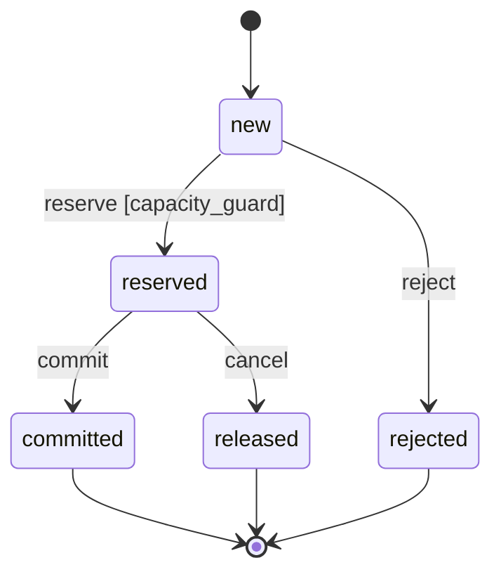

# Reference ledger

The [canonical example](../examples/refund-ledger/spec.json) models a fictional local refund ledger per tenant/payment. It has no real money, banking provider, credentials or network effects. It is release 1.1.0 of the example; [release 1.0.0](../examples/refund-ledger/releases/1.0.0.json) is kept beside it so the two can be compared.

A [reference implementation](../examples/refund-ledger/app/ledger.py) on SQLite and its [tests](../examples/refund-ledger/tests/test_ledger.py) exist so that the test plan runs against a real store. They are a demonstration of the method, not a product.

Both releases are approved by signature, and release 1.1.0 pins a second, very small specification, the [identity adapter](../examples/identity-adapter/spec.json). The `examples` directory is a complete release store.

## Decisions and vocabulary

Reserved and committed amounts consume captured capacity. Cancellation releases capacity but retains the idempotency key. Same key and payload returns the existing result; conflicting payload is refused. Keys are scoped to tenant/payment and retained for the example ledger's lifetime.

A refused reservation leaves no record (DEC-002). A cancel or commit command applies only to a reserved record: repeating a command that was already applied is reported as already done, any other command on a record that is not reserved is refused, and neither changes the ledger (DEC-003).

Amounts are safe integer euro cents in this example. A real product must explicitly decide durability, purge, availability and provider integration. Observation bounds do not prove behavior beyond the modeled data.

`auth.verified` is a projection from an authentication adapter. A client-supplied Boolean is not authentication. The tests simulate the adapter; they do not establish its trustworthiness.

## Requirements

Weights are in tenths of a point (`weight_minor_units` is 10), so 950 reads 95.0 points.

| ID | Weight | Risk band | Behavior | Executed test of the behavior |
|---|---|---|---|---|
| REQ-001 | 70.0 | high | Refuse over-capacity reservation without mutation | Boundaries, forced interleaving of two writers |
| REQ-002 | 60.0 | high | Same key/payload retrieves the prior result | Retry, retry after a lost response, retry after restart |
| REQ-003 | 60.0 | high | Same key/different payload is refused | Original record read back unchanged |
| REQ-004 | 95.0 | critical | Deny unauthorized tenant access | Three kinds of wrong caller, five operations, identical answer for a missing payment |
| REQ-005 | 55.0 | high | Cancel reservation and release capacity | Capacity reusable, key retained, repeated cancellation |
| REQ-006 | 70.0 | high | Commit without double consumption | Through the public entrypoint, sum read back |
| REQ-007 | 37.5 | medium | Bounded audit without secrets/raw payload | CON-011 on the rows of seven attempts; stored rows searched for the credential, body, key and amount |
| REQ-008 | 65.0 | high | Admit a fitting request as exactly one reserved record | New key beside an existing record |
| REQ-009 | 60.0 | high | Leave the ledger unchanged when a command does not apply | Five inapplicable commands, ledger read back identical |
| REQ-010 | 20.0 | low | Where the report is enabled, report remaining capacity | CON-012 on each answer, with FLAG-001 on and with it off |

REQ-008 was added in edition 0.4.0. Until then every requirement was a refusal, a retry or a later transition: a ledger that refused everything satisfied them all. REQ-009 was added in release 1.1.0: nothing said what a cancel or commit does to a record that is committed, released or missing, and a gate cannot detect a requirement nobody wrote. REQ-010 exists to exercise a feature flag.

## Predicates

| ID | Role | Property |
|---|---|---|
| CON-001 | invariant | Reserved plus committed total <= captured capacity |
| CON-002 | admission_guard | Positive request and sufficient remaining capacity |
| CON-003 | invariant | Existing rows have positive amounts |
| CON-004 | invariant | Each key occurs at most once in the observed ledger |
| CON-005 | admission_guard | Verified principal, request and resource tenants agree |
| CON-006 | review | Diagnostic clarity under a review protocol |
| CON-007 | observation_assertion | After a replay, refusal, conflict or denial, every earlier record and the captured amount are unchanged and no record was added |
| CON-008 | observation_assertion | After an admission, exactly one record was added: reserved, with the requested key and amount |
| CON-009 | observation_assertion | After a repeated, refused, unknown-record or denied command, the ledger is unchanged |
| CON-010 | observation_assertion | After an applied command, exactly the targeted record moved, from reserved to released for a cancel or to committed for a commit |
| CON-011 | observation_assertion | An audited attempt added exactly one audit row, equal to its operation identifier, operation kind and outcome |
| CON-012 | observation_assertion | With the report enabled, the answer is the captured capacity minus the consumed capacity; with it disabled, no amount is given |

Snapshot uniqueness does not establish temporal idempotence. A false guard can represent a correct refusal, while a false invariant identifies an invalid state.

## State view

The model references effects but does not define executable transition transformations. This explanatory view is not an exhaustive concurrent-state proof.

## Reference observations

[observations.json](../examples/refund-ledger/observations.json) contains 35 synthetic observations with 89 expectations. Nine are single ledger snapshots in ENV-001, each with five Boolean expectations.

| Scenario | Case | Expected distinction |
|---|---|---|
| SCN-001 | 600 reserved + 400 committed against 1,000; another request | Valid state, admission refused |
| SCN-002 | 600 + 401 against 1,000 | Capacity violation detected |
| SCN-003 | Empty ledger, request 400 | Admission possible; collection invariants are vacuous |
| SCN-004 | Zero row and zero request | Positivity violated; admission refused |
| SCN-005 | Duplicate key | Uniqueness violation |
| SCN-006 | Wrong request tenant | Authorization guard false |
| SCN-007 | 700 released, 400 committed, request 600 | Released amount no longer consumes capacity |
| SCN-008 | Unverified principal | Authorization guard false |
| SCN-009 | Principal/request agree but resource tenant differs | Resource ownership must also be checked |

Nine are before/after observations of one reservation attempt in ENV-002, each with two expectations (CON-007, CON-008).

| Scenario | Before -> after, outcome | Expected distinction |
|---|---|---|
| SCN-010 | Request over capacity; ledger identical; rejected | Refusal changed nothing |
| SCN-011 | Same, but a rejected record appeared | CON-007 false: a refusal wrote a record |
| SCN-012 | Same key and payload; ledger identical; replayed | Retry, also after a lost response, added nothing |
| SCN-013 | Same, but a second record with the same key appeared | CON-007 false: the retry duplicated |
| SCN-014 | Same key, different amount; ledger identical; conflict | Original record intact |
| SCN-015 | New key beside an existing record; one record added; reserved | Admission added exactly the requested record |
| SCN-016 | Same, but the added record holds another amount | CON-008 false: wrong amount recorded |
| SCN-017 | Denied caller; ledger identical; denied | Denial changed nothing |
| SCN-035 | Denied caller, but a reserved record appeared | CON-007 false: a denial changed the ledger |

Nine are before/after observations of one cancel or commit command in ENV-003, each with two expectations (CON-009, CON-010).

| Scenario | Command, before -> after, outcome | Expected distinction |
|---|---|---|
| SCN-018 | Cancel a reserved record; it becomes released | Only the target moved |
| SCN-019 | Same, but another record changed too | CON-010 false: a bystander record moved |
| SCN-020 | Commit a reserved record; it becomes committed | Only the target moved, nothing added |
| SCN-021 | Commit reported; the record is still reserved | CON-010 false: the commitment was not applied |
| SCN-022 | Cancel a committed record; ledger identical; refused | A terminal record does not move |
| SCN-023 | Same, but the committed record was released | CON-009 false: a refused command moved a record |
| SCN-024 | Cancel a released record; ledger identical; repeated | Repetition changes nothing and keeps the key |
| SCN-025 | Commit an unknown record; ledger identical; not found | Nothing is created |
| SCN-026 | Command from another tenant; ledger identical; denied | Denial changed nothing |

Five observe one attempt and the audit rows it added, in ENV-004, each with one expectation (CON-011).

| Scenario | Attempt -> rows added | Expected distinction |
|---|---|---|
| SCN-027 | Denied reservation `op-7`; one row (`op-7`, reserve, denied) | A denial is on record, by identifier, kind and outcome |
| SCN-028 | Commit `op-8`; one row (`op-8`, commit, committed) | A completed attempt is recorded the same way |
| SCN-029 | Denied reservation `op-7`; the row's identifier holds the bearer credential | CON-011 false: the row holds something other than the identifier |
| SCN-030 | Reservation `op-9`; the row's outcome also holds the key and amount | CON-011 false: the request body was copied |
| SCN-031 | Denied reservation `op-7`; no row | CON-011 false: the attempt was not recorded |

Three observe one report request by a verified principal of the ledger tenant and its answer, in ENV-005, each with one expectation (CON-012).

| Scenario | Flag, ledger -> answer | Expected distinction |
|---|---|---|
| SCN-032 | Enabled; 1,000 captured, 600 consumed; 400 reported | The report is what remains |
| SCN-033 | Enabled; same ledger; 1,000 reported | CON-012 false: the consumed capacity was ignored |
| SCN-034 | Disabled; same ledger; nothing reported | No amount is disclosed while the report is off |

CON-011 fixes what each field equals, which leaves no room for a credential or a body. An attempt that reaches no operation (a malformed request, or a store that is busy) is not an authorization attempt, writes no row and is outside ENV-004.

Each before/after predicate is an implication, so it is vacuously true for outcomes it does not concern; the counterexamples show that each can fail. CON-007 and CON-008 are compared with direct calculations on 200 seeded transitions in package QA.

## Executed tests

All 20 TestCases are implemented, bound to a test class and executed by package QA: 34 test methods against SQLite database files in a temporary directory. A receipt records the executed test IDs and the digest of every executed input; it stops being accepted as soon as the application, the tests, the specification or the evaluator changes.

Three things make these more than green ticks.

- **The specification's formulas are the oracle.** Every reservation, cancellation and commitment in the tests is wrapped in a before/after observation read back from the store, and CON-007 to CON-010 are evaluated on it. CON-011 is evaluated on the audit rows each attempt added, and CON-012 on each report answer with the ledger read back. The admission guard and the principal guard in the code are compared with CON-002 and CON-005 at their boundaries. A property test checks CON-001, CON-003 and CON-004 after each of 600 seeded operations and requires that every outcome of every operation occurred.
- **The dangerous interleaving is forced, not hoped for.** A second reservation is started inside the first one's critical section, after its capacity check. The ledger turns it away and admits one. The same interleaving run against a variant without the transaction admits both and reaches 1,200 against 1,000: the test fails on the defect it exists to catch. A third case runs two real threads.
- **Failure points are named.** A response lost after commit, a restart after a write and a stop between check and commit each have a test that states what is durable and what a retry returns. A reader blocking commit leaves no refund or audit row, and the same connection can retry once the reader releases its lock.

Implementing the tests settled one detail the prose had left open: a retry of a cancelled reservation's key returns the released record as a replay, because the key is retained.

## Release 1.1.0

Release 1.0.0 is the ledger of edition 0.4.0 migrated to format 0.2 with reviewed weights. Release 1.1.0 adds the cancel/commit, audit and report environments, REQ-009, REQ-010 behind FLAG-001, CON-009 to CON-012, eighteen scenarios, four tests, the real bindings and the import of the identity adapter. The comparison (gate G14, `python3 qa/release_diff.py`) reports 136 changed objects. CON-012 is a new rule on REQ-010, which is itself new, so it is not a breaking candidate.

| Output | Result |
|---|---|
| Breaking candidates | CON-009, CON-010 and CON-011: new hard rules on REQ-004 to REQ-007, which 1.0.0 already had |
| Recorded decision | DEC-004: compatible. They state what those requirements already required |
| Required step | minor, which is what 1.1.0 declares |
| Change risk score | 194.25 points of 592.5 active points: 32.7% |

The classifier cannot know that CON-010 only writes down what REQ-005 and REQ-006 said, so it asks, and the answer is on record. Without DEC-004 the release fails with three unacknowledged candidates.

The score separates two groups. REQ-004 to REQ-007, REQ-009 and REQ-010 are reached by additions and count at 50%. The other four are reached only because their tests changed state and count at 10%. REQ-004 alone contributes 47.5 points: a reviewer with limited time starts with tenant isolation.

FLAG-001 (`remaining_capacity_report`) ships disabled, was introduced in 1.1.0 and must be gone by 1.3.0. TEST-019 runs with it on, TEST-020 with it off, and the implementation's default is checked against the state the release declares.

## Approvals, the import and the store

The ledger's policy asks for no approver in the low band, one in the medium and high bands and two in the critical band, where only the `device_passkey` method counts. Two keys are declared, one per approver role. These numbers are this example's; another organization writes its own.

| Release | Governed by | Bands required | Approvals |
|---|---|---|---|
| Ledger 1.0.0 | itself, as a first release | all four: it reaches every requirement | ACTOR-001 and ACTOR-003, by passkey |
| Ledger 1.1.0 | ledger 1.0.0 | all four: it reaches REQ-004, which is critical | ACTOR-001 and ACTOR-003, by passkey |
| Identity adapter 1.0.0 | itself | low and critical | ACTOR-001, attested by the approval service through `sso_mfa` |

The identity adapter shows the other route: its policy accepts single sign-on with a second factor, and the signature is the approval service's, vouching for the person. Its low and medium bands ask for nobody.

Release 1.1.0 pins identity adapter 1.0.0 by digest and declares two uses: REQ-004 relies on the adapter's REQ-001, and the ledger's principal (TERM-005) is the adapter's verified principal (TERM-001). If the adapter changed REQ-001 in a breaking way, the impact report would reach REQ-004 at the dependent cap: 95 points at 25%, 23.75 points.

`python3 qa/release_store.py verify examples` reads the three releases and their approvals and checks every link, approval and pin from the files alone.

The keys are fictional. Each private key is derived from a public label so that the example can be re-signed by anyone, and the passkey assertions come from a simulated authenticator. They show that the rules work, not that anyone approved anything.

## What an agent is given

The ledger code carries seven annotations naming thirteen IDs, such as `# @req REQ-004 CON-005` above `authorize`. With the 31 bindings they yield the 44 traces of the [graph index](../examples/refund-ledger/axiom-graph.json), a 31 KB file beside a 220 KB specification.

A search of the index for `Ledger.command` returns three lines: REQ-005, REQ-006 and REQ-009. The brief of REQ-005 is 3.8 KB. What binds REQ-005 and REQ-009 together is 22 objects in one 24 KB page. The context of a change to them is 99 objects in three pages, because the two hard project rules bring the capacity and tenant requirements with their scenarios and tests.

## Remaining gaps

- The `gaps` query reports nothing on the ledger, and package QA requires that. Until edition 0.7.2 REQ-010 had no scenario and REQ-004 no counterexample; every must requirement now has a witness and a counterexample.
- BCIR has no substring operator. CON-011 states what each audit field equals; "no stored column contains the credential" is still asserted in test code on the raw rows.
- After DEC-002 nothing writes a `rejected` record, yet the status and TRN-002 remain. Removing them is a breaking change to the model and the environments; it is left for a major release.
- A before/after pair describes one completed attempt. Interleaving is covered by the executed concurrency test on SQLite, not by a predicate, and no other store is qualified.
- CON-004 is quadratic and exceeds the reference step budget at 500 rows although the schema admits 1,000. CON-007 is unknown from 267 rows; CON-009 and CON-010 have the same form. Qualify a more efficient realization before claiming full-bound coverage.
- The evidence is local and its producer untrusted. The approvals verify against declared keys, but the keys are fictional and nothing binds a key to a person. No hardware authenticator was used, and there is no runtime observation (G13).
- The aeion-factory engine reported `design_ready` for the edition 0.4.0 ledger. It reads format 0.1 and has not been run on release 1.1.0.

For a cancellation change, retrieve REQ-005, REQ-009, terms, applicable constraints, MODEL-001, tests and bindings, including project-level capacity and authorization rules. Unmodeled key purging is an unmapped change, not proof of no impact.

The optional execution declaration and CROA sidecar demonstrate metadata shape and unknown handling. They add no deployed authority or CROA conformance to this ledger.
