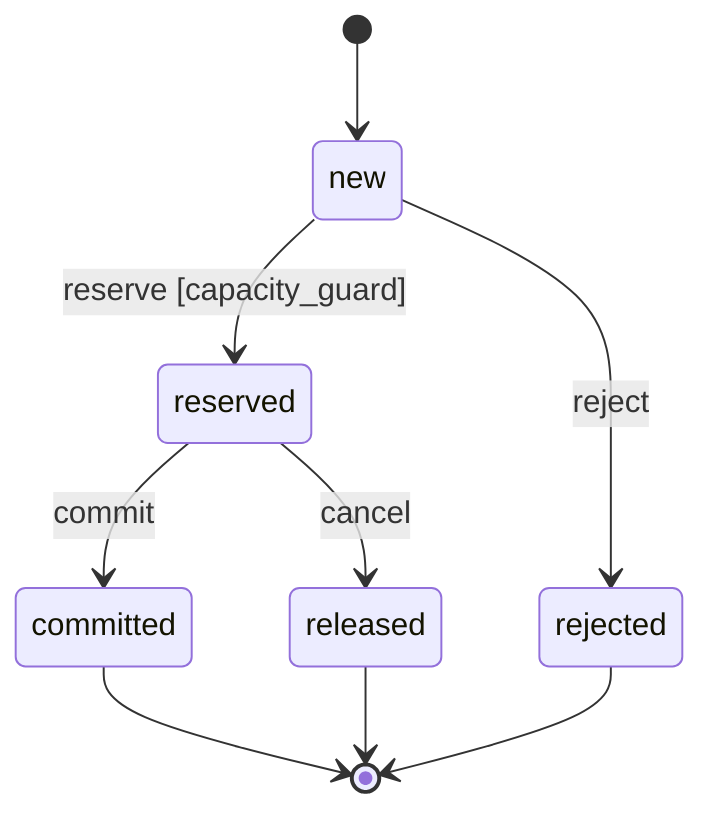

# Reference ledger

The [canonical example](../examples/refund-ledger/spec.json) models a fictional local refund ledger per tenant/payment. It has no real money, banking provider, credentials or network effects. Test bindings are planned paths, not existing application code.

## Decisions and vocabulary

Reserved and committed amounts consume captured capacity. Cancellation releases capacity but retains the idempotency key. Same key and payload returns the existing result; conflicting payload is refused. Keys are scoped to tenant/payment and retained for the example ledger's lifetime.

Amounts are safe integer euro cents in this example. A real product must explicitly decide durability, purge, availability and provider integration. Observation bounds do not prove behavior beyond the modeled data.

`auth.verified` is a projection from an authentication adapter to build. A client-supplied Boolean is not authentication. The reference evaluator tests the predicate, not the adapter's trustworthiness.

## Requirements

| ID | Behavior | Application verification still to implement |
|---|---|---|
| REQ-001 | Refuse over-capacity reservation without mutation | Boundaries and real transaction concurrency |
| REQ-002 | Same key/payload retrieves the prior result | Retry after lost response; no extra row |
| REQ-003 | Same key/different payload is refused | Persistent state unchanged |
| REQ-004 | Deny unauthorized tenant access | Refuse before disclosure/mutation |
| REQ-005 | Cancel reservation and release capacity | Transition, retained key and repeated cancellation |
| REQ-006 | Commit without double consumption | Durable transition and preserved sum |
| REQ-007 | Bounded audit without secrets/raw payload | Event inspection and sensitive-data tests |
| REQ-008 | Admit a fitting request as exactly one reserved record | Admission through the real storage boundary |

REQ-008 was added in edition 0.4.0. Until then every requirement was a refusal, a retry or a later transition: a ledger that refused everything satisfied them all, and the scenarios and tests that reserve successfully had no requirement to point to. DEC-002 records the reading of "without changing the ledger" that the before/after predicates rely on: a refusal leaves no record.

All 16 TestCases are planned. Four normal-path markers and two overly broad verification links were corrected during review. The fourth review removed twelve scenario references from tests whose requirements those scenarios do not illustrate, 25 `uses_term` links that connected every requirement to every term, and the link from the audit requirement to the capacity goal; REQ-007 now satisfies its own GOAL-003. TEST-013 is left with no scenario: none exists for audit output. Missing behavioral scenarios remain visible rather than being replaced by extra links.

## Predicates

| ID | Role | Property |
|---|---|---|
| CON-001 | invariant | Reserved plus committed total <= captured capacity |
| CON-002 | admission_guard | Positive request and sufficient remaining capacity |
| CON-003 | invariant | Existing rows have positive amounts |
| CON-004 | invariant | Each key occurs at most once in the observed ledger |
| CON-005 | admission_guard | Verified principal, request and resource tenants agree |
| CON-006 | review | Diagnostic clarity under a review protocol |
| CON-007 | observation_assertion | After a replay, refusal, conflict or denial, every earlier record and the captured amount are unchanged and no record was added |
| CON-008 | observation_assertion | After an admission, exactly one record was added: reserved, with the requested key and amount |

Snapshot uniqueness does not establish temporal idempotence. A false guard can represent a correct refusal, while a false invariant identifies an invalid state.

## State view

The model references effects but does not define executable transition transformations. This explanatory view is not an exhaustive concurrent-state proof.

## Reference observations

[observations.json](../examples/refund-ledger/observations.json) contains 17 synthetic observations. Nine are single ledger snapshots in ENV-001, each with five Boolean expectations.

| Scenario | Case | Expected distinction |
|---|---|---|
| SCN-001 | 600 reserved + 400 committed against 1,000; another request | Valid state, admission refused |
| SCN-002 | 600 + 401 against 1,000 | Capacity violation detected |
| SCN-003 | Empty ledger, request 400 | Admission possible; collection invariants are vacuous |
| SCN-004 | Zero row and zero request | Positivity violated; admission refused |
| SCN-005 | Duplicate key | Uniqueness violation |
| SCN-006 | Wrong request tenant | Authorization guard false |
| SCN-007 | 700 released, 400 committed, request 600 | Released amount no longer consumes capacity |
| SCN-008 | Unverified principal | Authorization guard false |
| SCN-009 | Principal/request agree but resource tenant differs | Resource ownership must also be checked |

Eight are before/after observations of one reservation attempt in ENV-002, each with two expectations (CON-007, CON-008).

| Scenario | Before -> after, outcome | Expected distinction |
|---|---|---|
| SCN-010 | Request over capacity; ledger identical; rejected | Refusal changed nothing |
| SCN-011 | Same, but a rejected record appeared | CON-007 false: a refusal wrote a record |
| SCN-012 | Same key and payload; ledger identical; replayed | Retry, also after a lost response, added nothing |
| SCN-013 | Same, but a second record with the same key appeared | CON-007 false: the retry duplicated |
| SCN-014 | Same key, different amount; ledger identical; conflict | Original record intact |
| SCN-015 | New key beside an existing record; one record added; reserved | Admission added exactly the requested record |
| SCN-016 | Same, but the added record holds another amount | CON-008 false: wrong amount recorded |
| SCN-017 | Denied caller; ledger identical; denied | Denial changed nothing |

Both predicates are implications, so each is vacuously true for outcomes it does not concern; the counterexamples show that each can fail. They are compared with direct calculations on 200 seeded transitions in package QA.

## Implementation gaps

Two requests of 600 may each satisfy a guard against the same initial capacity of 1,000. Without atomic admission, their writes overbook. CTRL-001 therefore requires a persistent atomic boundary and forced-interleaving integration tests. The formula alone does not implement that boundary.

Edition 0.4.0 closed the plan gaps that kept G07 failing: REQ-003 and REQ-004 now have a normal case (TEST-015, TEST-016), and retry, refusal, conflict and denial have before/after scenarios. Run on this ledger, the aeion-factory 3.0.0 engine reports G01-G07 pass and `design_ready: pass`. That is a statement about the declared model and plan of a fictional example. This package's own QA emits no phase status, and the following remain open:

- Cancellation, commitment and audit output (REQ-005, REQ-006, REQ-007) have snapshot scenarios or none; they have no before/after observation. TEST-013 still cites no scenario.
- No requirement says what happens when a command targets a record in the wrong state, such as cancelling a committed record. A gate cannot detect a requirement nobody wrote.
- After DEC-002 nothing in the modeled path writes a `rejected` record, yet the status and TRN-002 remain. The decision's rationale keeps that visible.
- A before/after pair describes one completed attempt. It does not cover two attempts interleaving; that is still CTRL-001 and TEST-007.
- G10 has no executed application evidence. All 16 tests are planned.

CON-004 is quadratic and exceeds the reference step budget at 500 rows although the schema admits 1,000. CON-007 compares every earlier record with every later one and is quadratic too: an unchanged ledger completes up to 266 rows and is unknown from 267. Qualify a more efficient realization before claiming full-bound coverage.

For a cancellation change, retrieve REQ-005, terms, applicable constraints, MODEL-001, tests and bindings, including project-level capacity and authorization rules. Inspect actual code when it exists. Unmodeled key purging is an unmapped change, not proof of no impact.

The optional execution declaration and CROA sidecar demonstrate metadata shape and unknown handling. They add no deployed authority or CROA conformance to this ledger.
