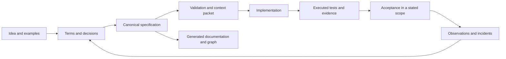

# Æion Framework

**The idea behind Æion's way of specifying software, and nothing else.** This repository holds the
method: the AxiomSpec package and its two playbooks, for a new project and for an existing one. The
code that executes the method lives in other repositories, so the framework can be read, criticised
and reused without adopting any tool.

| | Repository | What it holds |
| --- | --- | --- |
| The framework | **aeion-framework** (here) | The AxiomSpec contracts, schemas, worked example and playbooks |
| The template | [aeion-factory](https://github.com/OualidGuennif/aeion-factory) | A project template that makes the method executable (`tools/axiom`, Python standard library only) |
| The execution | [aeion-core](https://github.com/OualidGuennif/aeion-core) | A local web app that takes a feature from brainstorm to a checked specification |

## The idea

Coding agents write code faster than anyone can check what the code was supposed to do. The usual
answer, a longer prompt or a longer document, makes that worse: prose cannot be validated, and nobody
can say which sentence a test proves.

AxiomSpec replaces the prose with **one canonical specification per product**, a single `spec.json`
that a person or an agent can author and a program can check:

- **Everything has a stable ID and typed links.** Goals, terms, requirements, decisions, constraints,
  state models, scenarios, test cases and implementation bindings refer to each other explicitly.
- **Uncertainty is written down.** An open question or an assumption is a recorded item, not a gap
  someone fills silently.
- **Gates say what was actually checked.** Each gate reports pass, fail or unknown, and unknown is
  never pass. A declared link to code is not proof of behaviour; an executed test with a receipt is.
- **Documentation, diagrams and the graph are derived views.** They are regenerated from the
  specification and never edited as a second source of truth.
- **The core is deterministic and local.** No model API, server or graph database is required to
  validate a specification.
- **People keep the decisions.** Checks make declared properties reproducible; they do not establish
  that the chosen requirements are right for the business.
- **Every specification is a release.** It carries a version and names the release before it. A
  deterministic comparison lists what changed by ID, flags breaking candidates, requires a recorded
  decision for each and states the version step the changes need.
- **Every requirement has a weight.** An integer from 1 to 100 points, in declared minor units. A
  change risk score adds up the weight of what a release touches, so review starts where it matters.
  The score ranks; it never turns a failed gate into a pass.
- **Feature flags are part of the specification.** A flag has a state per release, a test for each
  state and a removal target, after which keeping it fails the check.



## What is here

| Path | Content |
| --- | --- |
| [`AxiomSpec/`](AxiomSpec/README.md) | The AxiomSpec package, edition 0.5.1: nineteen contract documents, four JSON schemas, the rule index, a worked example (a fictional refund ledger in two releases, with a reference implementation and executed tests), a conformance corpus, a release comparison, a migration from format 0.1, package QA and its review records |
| [`playbooks/01_NEW_PROJECT_AXIOMSPEC.md`](playbooks/01_NEW_PROJECT_AXIOMSPEC.md) | The new-project playbook: from a new product idea to a specification, a human documentation cockpit and a small tested implementation |
| [`playbooks/02_EXISTING_PROJECT_NVIDIA_TO_AXIOMSPEC.md`](playbooks/02_EXISTING_PROJECT_NVIDIA_TO_AXIOMSPEC.md) | The existing-project playbook: recovering the meaning of a product that already has difficult relational data, then moving it to an AxiomSpec specification |
| [`tools/check_repo.py`](tools/check_repo.py) | A check of this README and the playbooks (links, JSON examples, the specification draft), which the self-contained package QA cannot read |

The two playbooks are the source material Æion Factory 3.0.0 and Æion Core were built from. The
existing-project playbook is a verbatim copy; the specification draft in the new-project playbook was
moved to format 0.2 in edition 0.5.0.

The package is edition 0.5.1, with specification format `axiomspec/0.2`. Release, weights and flags
are required fields, so a 0.1 specification is not valid 0.2: `AxiomSpec/qa/migrate_0_1.py` writes a
candidate and lists what a person must still decide. Æion Factory and Æion Core vendor edition 0.3.0
(this repository at commit `43cfb58`) and read format 0.1; they have not been moved yet. The
[review](AxiomSpec/REVIEW.md#edition-050) lists every change since 0.3.0, so a tool built from it can
see what it does not check yet.

The existing-project playbook cites a research note (`../research/auto-ontology-comparison-2026-11-09.md`)
that is not published; that one link does not resolve.

## Where to start

1. Read the [package overview](AxiomSpec/README.md) and its reading guide.
2. Follow the [new-project playbook](playbooks/01_NEW_PROJECT_AXIOMSPEC.md) for a first specification, or the
   [existing-project playbook](playbooks/02_EXISTING_PROJECT_NVIDIA_TO_AXIOMSPEC.md) when the product already exists.
3. Look at the [worked example](AxiomSpec/docs/13_REFUND_LEDGER_WALKTHROUGH.md) and its
   [canonical data](AxiomSpec/examples/refund-ledger/spec.json).
4. To run the method instead of reading it, use [aeion-factory](https://github.com/OualidGuennif/aeion-factory).

## Status and limits

- This is a design package. It defines contracts and includes checks of the package itself; it
  contains no product CLI, compiler, graph engine or runner adapter. The commands the package names
  `axiom ...` are proposed interfaces here, and exist as code in aeion-factory for format 0.1.
- The refund ledger is fictional. Its 20 test cases run against a reference implementation on local
  SQLite every time the package is verified, and its release 1.1.0 is compared with its release
  1.0.0. That is evidence about one example from an untrusted local producer, not a qualified runner.
- One specification is one file of at most one megabyte, about a thousand requirements. References
  between the specifications of separate services are not defined yet, and nothing authenticates who
  approved a decision.
  The package's own [review](AxiomSpec/REVIEW.md) and
  [assurance matrix](AxiomSpec/review/ASSURANCE_MATRIX.md) list what is declared, what is checked and
  what is not built.
- The package QA can be replayed (the run rewrites the receipts under `AxiomSpec/review/` and
  `AxiomSpec/validation/`):

  ```bash
  python3 -m venv .venv && .venv/bin/pip install -r AxiomSpec/qa/requirements-qa.txt
  cd AxiomSpec && PATH="$PWD/../.venv/bin:$PATH" python3 qa/run_checks.py
  ```

  `.venv/bin/python tools/check_repo.py` then checks this README and the playbooks. Both run on
  every push (`.github/workflows/qa.yml`). To compare two releases of a specification:

  ```bash
  cd AxiomSpec && ../.venv/bin/python qa/release_diff.py examples/refund-ledger/releases/1.0.0.json examples/refund-ledger/spec.json
  ```

## License

[MIT](LICENSE).
