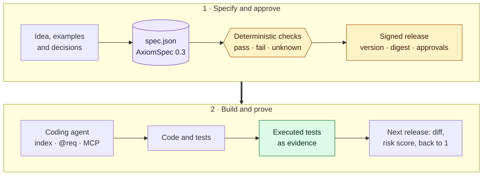

# Æion Framework

[](https://github.com/OualidGuennif/aeion-framework/actions/workflows/qa.yml)
[](https://github.com/OualidGuennif/aeion-framework/releases)


[](LICENSE)

AxiomSpec 0.3 is a format for writing down what a product must do, in one `spec.json` file that a
program can check. Every goal, requirement, constraint, scenario and test in it has an ID and links to
the others, so you can ask which test covers a requirement, what a release changed, and who approved it.

Coding agents now write code faster than people can check it against what was asked. A prompt or a
design document does not help much there: no checker runs on prose, and nobody can say which sentence a
given test proves. AxiomSpec keeps the same content as structured data, and the checks in this
repository read it.



## What it does

Each check answers pass, fail or unknown, and unknown never counts as a pass. A requirement linked to
code is only a claim until an executed test with a receipt covers it.

Every specification names the release before it. Comparing two releases lists each change by ID, says
whether the version needs a patch, minor or major step, and computes a risk score from the weights of
the requirements touched. In the example ledger, release 1.1.0 has 136 changes, needs a minor step and
scores 194.25 points.

The specification also holds its own approval policy: how many approvers each risk band needs, and
which methods count (passkeys, single sign-on, or whatever your approval service signs). The
signatures are checked from the files, with no server involved.

A coding agent never reads the whole specification. It gets a 31 KB index instead of the 220 KB file,
code annotated with `@req`, and a read-only service over HTTP and MCP. When it is unsure, it asks for
one requirement, for what constrains it, or for everything a change touches.

Verification needs only files. There is no database, log or clock, and the result is the same in
whatever order the files arrive and from whichever copy they come. A missing file makes the answer
unknown, and two conflicting releases are reported as a fork.

Specifications can depend on each other. A product pins the releases of the services it uses by
digest, and when a provider changes, the comparison follows the change into each consumer's
requirements.

An annotation in the code, and the request an agent sends to read that requirement:

```python
# @req REQ-004 CON-005
def authorize(principal, request_tenant, resource_tenant):
```

```bash
curl -s http://127.0.0.1:8787/v1/snapshots/current/nodes/REQ-004
```

## What is here

| Path | Content |
| --- | --- |
| [`AxiomSpec/`](AxiomSpec/README.md) | The package, edition 1.0.2: contracts, JSON schemas, reference checks and the service contract, with a worked example (a fictional [refund ledger](AxiomSpec/docs/13_REFUND_LEDGER_WALKTHROUGH.md) in two signed releases, with executed tests) |
| [`server/`](server/README.md) | The reference service, which answers the package's queries over HTTP and MCP, either for one task in a sandbox or for a whole organization |
| [`playbooks/`](playbooks/01_NEW_PROJECT_AXIOMSPEC.md) | Three procedures: [a new project](playbooks/01_NEW_PROJECT_AXIOMSPEC.md), [an existing one](playbooks/02_EXISTING_PROJECT_NVIDIA_TO_AXIOMSPEC.md), and [an agent in a sandbox](playbooks/03_AGENT_IN_A_SANDBOX.md) |

The Æion family:

| Repository | Role |
| --- | --- |
| aeion-framework (this one) | The method itself: the format, the checks, the example and the playbooks |
| [aeion-factory](https://github.com/OualidGuennif/aeion-factory) | A project template that makes the method executable |
| [aeion-core](https://github.com/OualidGuennif/aeion-core) | A local web app that takes a feature from brainstorm to a checked specification |

## Quick start

With Python 3.14 or later:

```bash
python3 -m venv .venv && .venv/bin/pip install -r AxiomSpec/qa/requirements-qa.txt -r server/requirements.txt
cd AxiomSpec && PATH="$PWD/../.venv/bin:$PATH" python3 qa/run_checks.py
```

This replays the package QA (213 tests, plus the ledger's own tests and the reference checks) and
rewrites its receipts. To compare the two releases of the ledger:

```bash
../.venv/bin/python qa/release_diff.py examples/refund-ledger/releases/1.0.0.json examples/refund-ledger/spec.json
```

The service has its own [README](server/README.md) and tests
(`.venv/bin/python -m unittest discover -s server/tests`), and `tools/check_repo.py` checks this README
and the playbooks. CI runs all three on every push.

## Releases

Each release is a git tag, published on the
[releases page](https://github.com/OualidGuennif/aeion-framework/releases) with two archives made by
`git archive` and their SHA-256 digests. `axiomspec-X.Y.Z.tar.gz` holds the package alone, and
`aeion-framework-X.Y.Z.tar.gz` adds the service and the playbooks. To check the package, extract it and
run `python3 qa/run_checks.py`.

## Limits

- The checks and the service are reference implementations with their own tests. The service has no
  authentication and has not been load-tested. To run the method on a project, use aeion-factory.
- The only worked example is a fictional ledger. Its tests run on every check, but no real product has
  been specified with this edition, and nobody has measured yet whether the setup helps an agent.
- The checks show that a specification is consistent and that its tests pass. Whether the requirements
  are the right ones is up to the people who approve them.
- This edition reads format 0.3 only. `AxiomSpec/qa/migrate_0_1.py` and `migrate_0_2.py` convert older
  files, and aeion-factory and aeion-core still read format 0.1.

The [review](AxiomSpec/REVIEW.md) and the [assurance matrix](AxiomSpec/review/ASSURANCE_MATRIX.md) list
what is declared, what is checked and what is not built yet.

## License

[MIT](LICENSE).
