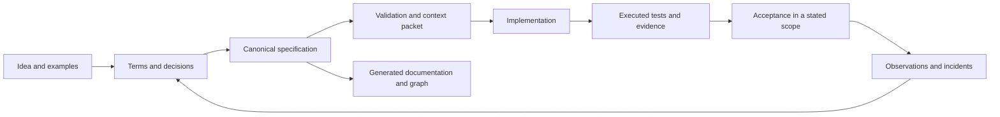

# Æion Framework

**The idea behind Æion's way of specifying software, and nothing else.** This repository holds the
method: the AxiomSpec package and the playbook for starting a new project with it. The code that
executes the method lives in other repositories, so the framework can be read, criticised and
reused without adopting any tool.

| | Repository | What it holds |
| --- | --- | --- |
| The framework | **aeion-framework** (here) | The AxiomSpec contracts, schemas, worked example and playbook |
| The template | [aeion-factory](https://github.com/OualidGuennif/aeion-factory) | A project template that makes the method executable (`tools/axiom`, Python standard library only) |
| The execution | [aeion-core](https://github.com/OualidGuennif/aeion-core) | A local web app that takes a feature from brainstorm to a checked specification |

## The idea

Coding agents write code faster than anyone can check what the code was supposed to do. The usual
answer, a longer prompt or a longer document, makes that worse: prose cannot be validated, and nobody
can say which sentence a test proves.

AxiomSpec replaces the prose with **one canonical specification per product**, a single `spec.json`
that a person or an agent can author and a program can check:

- **Everything has a stable ID and typed links.** Goals, terms, requirements, decisions, constraints,
  state models, scenarios, test cases and implementation bindings refer to each other explicitly.
- **Uncertainty is written down.** An open question or an assumption is a recorded item, not a gap
  someone fills silently.
- **Gates say what was actually checked.** Each gate reports pass, fail or unknown, and unknown is
  never pass. A declared link to code is not proof of behaviour; an executed test with a receipt is.
- **Documentation, diagrams and the graph are derived views.** They are regenerated from the
  specification and never edited as a second source of truth.
- **The core is deterministic and local.** No model API, server or graph database is required to
  validate a specification.
- **People keep the decisions.** Checks make declared properties reproducible; they do not establish
  that the chosen requirements are right for the business.



## What is here

| Path | Content |
| --- | --- |
| [`AxiomSpec/`](AxiomSpec/README.md) | The AxiomSpec package, edition 0.3.0: nineteen contract documents, four JSON schemas, the rule index, a worked example (a fictional refund ledger), a conformance corpus, package QA and its review records |
| [`playbooks/01_NEW_PROJECT_AXIOMSPEC.md`](playbooks/01_NEW_PROJECT_AXIOMSPEC.md) | The playbook: from a new product idea to a specification, a human documentation cockpit and a small tested implementation |

Both are verbatim copies of the source material Æion Factory 3.0.0 and Æion Core were built from.
The playbook mentions a second one, for existing projects; it is not part of this repository and is
published in [aeion-factory](https://github.com/OualidGuennif/aeion-factory/blob/main/knowledge/axiomspec/playbooks/02_EXISTING_PROJECT_NVIDIA_TO_AXIOMSPEC.md).

## Where to start

1. Read the [package overview](AxiomSpec/README.md) and its reading guide.
2. Follow the [new-project playbook](playbooks/01_NEW_PROJECT_AXIOMSPEC.md) for a first specification.
3. Look at the [worked example](AxiomSpec/docs/13_REFUND_LEDGER_WALKTHROUGH.md) and its
   [canonical data](AxiomSpec/examples/refund-ledger/spec.json).
4. To run the method instead of reading it, use [aeion-factory](https://github.com/OualidGuennif/aeion-factory).

## Status and limits

- This is a design package. It defines contracts and includes checks of the package itself; it
  contains no product CLI, compiler, graph engine or test adapter. The commands the package names
  `axiom ...` are proposed interfaces here, and exist as code in aeion-factory.
- The refund ledger is fictional, its application tests are planned, and it is not `design_ready`.
  The package's own [review](AxiomSpec/REVIEW.md) and
  [assurance matrix](AxiomSpec/review/ASSURANCE_MATRIX.md) list what is declared, what is checked and
  what is not built.
- The package QA can be replayed (the run rewrites the receipts under `AxiomSpec/review/` and
  `AxiomSpec/validation/`):

  ```bash
  python3 -m venv .venv && .venv/bin/pip install -r AxiomSpec/qa/requirements-qa.txt
  cd AxiomSpec && PATH="$PWD/../.venv/bin:$PATH" python3 qa/run_checks.py
  ```

## License

[MIT](LICENSE).
