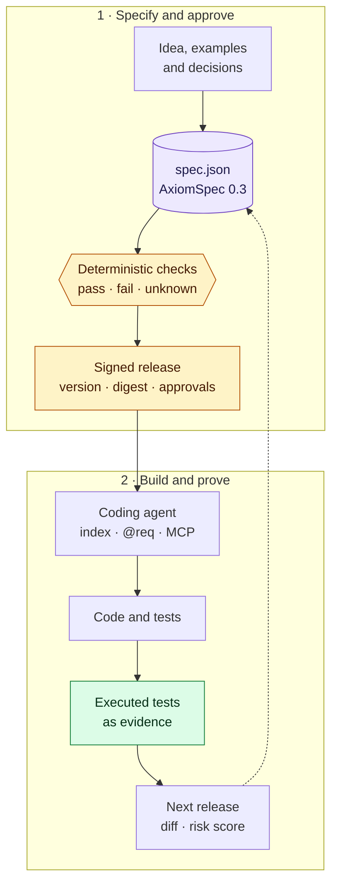

# Æion Framework

[](https://github.com/OualidGuennif/aeion-framework/actions/workflows/qa.yml)
[](https://github.com/OualidGuennif/aeion-framework/releases)


[](LICENSE)

**AxiomSpec 0.3: one checked specification per product. People approve it, agents follow it, and a
program says what is actually proven.**

Coding agents write code faster than anyone can check what it was supposed to do. A longer prompt or
a longer document makes that worse: prose cannot be validated, and nobody can say which sentence a
test proves. AxiomSpec replaces the prose with a single `spec.json` in which every goal, requirement,
constraint, scenario and test has an ID, a link and a status a program can check.



## Why it is interesting

- **Unknown is never pass.** Every gate answers pass, fail or unknown. A link to code is a claim; only
  an executed test with a receipt is evidence.
- **Releases you can diff.** Each specification names the release before it. A deterministic comparison
  lists every change by ID, states the version step it needs, and scores the risk from the weight of
  what was touched, so review starts where it matters.
- **Approvals with your rules.** The specification states how many approvers each risk band needs and
  which methods count (passkeys, single sign-on, anything your service signs). The signatures are
  checked from the files alone.
- **Agents get only what they need.** No agent reads the whole specification. It gets a 31 KB index
  instead of the 220 KB file, code annotated with `@req`, and a read-only service over HTTP and MCP
  that answers one requirement, what binds it, or the full context of a change.
- **Files, not servers.** No log, no database, no clock. The verdict depends on the set of files alone,
  in any order and from any replica: a missing file is unknown, a conflict is a reported fork.
- **Specifications compose.** A product pins the releases it relies on by digest, and a change in a
  provider is followed into the requirements of its consumers.

What it looks like in the code, and what an agent asks when in doubt:

```python
# @req REQ-004 CON-005
def authorize(principal, request_tenant, resource_tenant):
```

```bash
curl -s http://127.0.0.1:8787/v1/snapshots/current/nodes/REQ-004
```

## What is here

| Path | Content |
| --- | --- |
| [`AxiomSpec/`](AxiomSpec/README.md) | The package, edition 1.0.1: contracts, JSON schemas, reference checks, the service contract and a worked example, a fictional [refund ledger](AxiomSpec/docs/13_REFUND_LEDGER_WALKTHROUGH.md) in two signed releases with executed tests |
| [`server/`](server/README.md) | The reference service: the package's queries over HTTP and MCP, for one task in a sandbox or for a whole organization |
| [`playbooks/`](playbooks/01_NEW_PROJECT_AXIOMSPEC.md) | Three procedures: [a new project](playbooks/01_NEW_PROJECT_AXIOMSPEC.md), [an existing one](playbooks/02_EXISTING_PROJECT_NVIDIA_TO_AXIOMSPEC.md), and [an agent in a sandbox](playbooks/03_AGENT_IN_A_SANDBOX.md) |

The Æion family:

| Repository | Role |
| --- | --- |
| **aeion-framework** (here) | The method: format, checks, example and playbooks |
| [aeion-factory](https://github.com/OualidGuennif/aeion-factory) | A project template that makes the method executable |
| [aeion-core](https://github.com/OualidGuennif/aeion-core) | A local web app from brainstorm to a checked specification |

## Quick start

With Python 3.14 or later:

```bash
python3 -m venv .venv && .venv/bin/pip install -r AxiomSpec/qa/requirements-qa.txt -r server/requirements.txt
cd AxiomSpec && PATH="$PWD/../.venv/bin:$PATH" python3 qa/run_checks.py
```

That replays the whole package QA (213 tests, the ledger's executed tests, every reference check) and
rewrites its receipts. Then compare the two releases of the ledger:

```bash
../.venv/bin/python qa/release_diff.py examples/refund-ledger/releases/1.0.0.json examples/refund-ledger/spec.json
```

The service has its own [README](server/README.md) and tests
(`.venv/bin/python -m unittest discover -s server/tests`), and `tools/check_repo.py` checks this README
and the playbooks. All of it runs on every push.

## Releases

Each release is a tag with two archives and their SHA-256 digests on the
[releases page](https://github.com/OualidGuennif/aeion-framework/releases): `axiomspec-X.Y.Z.tar.gz`,
the package alone, and `aeion-framework-X.Y.Z.tar.gz`, with the service and the playbooks. Both are
`git archive` of the tag; extract the package and run `python3 qa/run_checks.py` to check it.

## Honest limits

- **A reference, not an engine.** The checks and the service are references with their own tests. The
  service authenticates nobody and was not load-tested. Running the method is aeion-factory's job.
- **One fictional example.** The ledger's tests run on every check, but no real product was specified
  with this edition, and the benefit to an agent is not measured yet.
- **Checks prove form, not intent.** They make declared properties reproducible; whether the
  requirements are the right ones stays a human decision.
- **Format 0.3 only.** Older specifications are migrated with `AxiomSpec/qa/migrate_0_1.py` and
  `migrate_0_2.py`; aeion-factory and aeion-core still read format 0.1.

The [review](AxiomSpec/REVIEW.md) and the [assurance matrix](AxiomSpec/review/ASSURANCE_MATRIX.md) say
exactly what is declared, checked and not built.

## License

[MIT](LICENSE).
